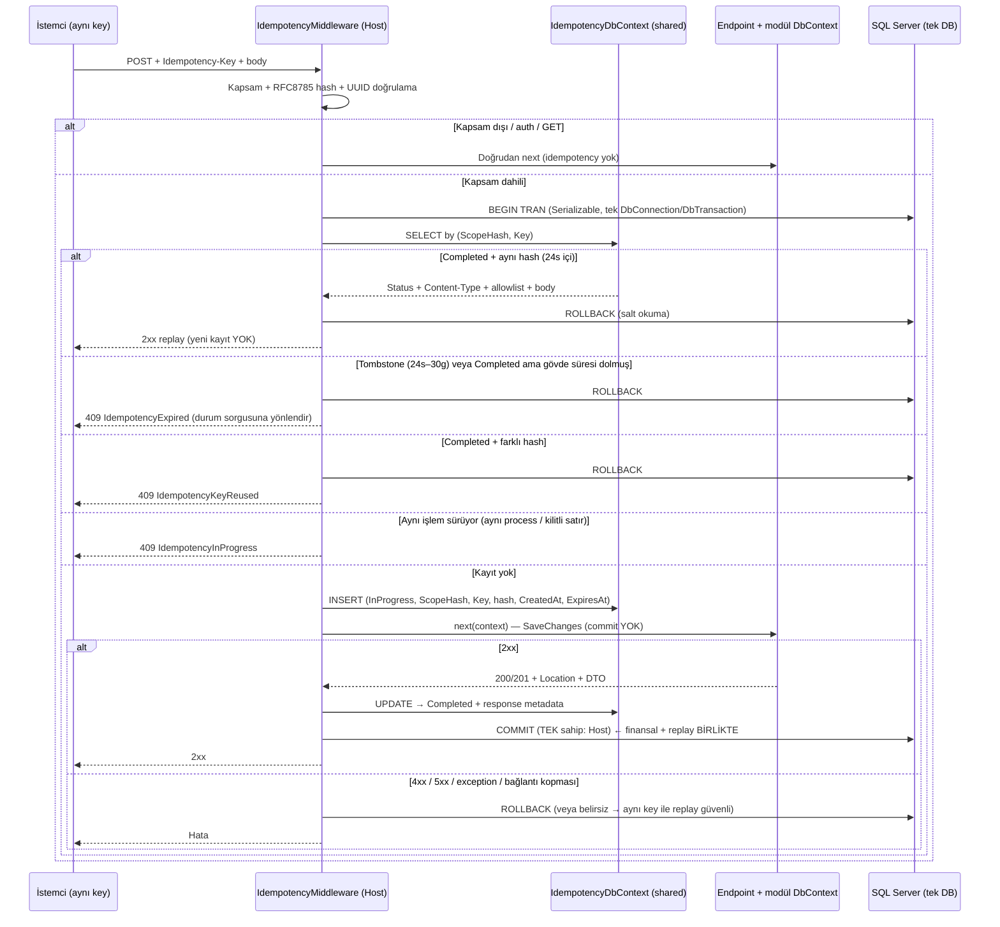

# FinTrack — Idempotency Teknik Tasarımı

**Sürüm:** 1.5
**Tarih:** 2026-11-21
**Durum:** ✅ V11-T01 + V11-T02 uygulandı; V12-T02 commit yolu temizliği ve kapsam sınırı testleri doğrulandı — Docker hariç **390/390**, gerçek Docker/Testcontainers + MSSQL entegrasyon **95/95**, çözüm build **0/0** — Windows manuel UI smoke operatör görevidir; V12-T02 kod/test değişiklikleri commit/push bekliyor, son yeşil CI `44931169879` (`1826dc7`)
**Bağlı belgeler:** [Kararlar v1.2](10-karar-bekleyen-konular.md) · [İş Kuralları §2.7](05-is-kurallari.md) · [API Sözleşmeleri §1.4](06-api-sozlesmeleri.md) · [ADR-0009](adr/0009-moduller-arasi-atomik-yazma.md) · [ADR-0010](adr/0010-host-owned-idempotent-writes.md) · [Görev kartı](07-yol-haritasi-ve-ajan-gorev-standardi.md) §5.1

> Bu dosya, `docs/10` kararlarının teknik tasarımı ve kullanıcının
> `docs/11-kararlar.txt` ile verdiği **altı koşullu onayın** işlendiği son
> tasarımdır. Kullanıcı şunu istedi: *"Dört kritik konunun çözüldüğünü göstermeden
> uygulama görevine geçme."* Bu dört konunun çözümü şu bölümlerdedir:
>
> | Kritik konu | Çözüm bölümü |
> |---|---|
> | Commit sonucu belirsizliği | §4.2 + §4.2.1 + test S21 |
> | RFC 8785 uyumluluğu | §3.2 + test S26/S27 |
> | 24 saatten uzun belirsiz mobil işlem | §7.5 + test S28/S29 |
> | Çoklu API instance eşzamanlılığı | §4.4.1 + test S4/S22–S24 |
>
> **Kodlama onayı alındı ve uygulama tamamlandı.** Kullanıcı, `5abb6af`
> commit'indeki dokümanları inceleyip açık kodlama onayı verdi (2026-11-19).
> Önce §3.2 bloklayıcı kapısı koşuldu; kapı sonucu §3.2.1'e işlendi. V11-T01
> kodu yazıldı; doğrulama sonuçları §9.5'te.

---

## 1. Kapsam ve onay durumu

| Madde | Karar | Durum (v1.2) |
|---|---|---|
| 1.1 | **A** | Finansal/mutasyon `POST` zorunlu; auth `POST` kapsam dışı |
| 1.2 | **A** | `userId + method + route template + route değerleri + anahtar`; query string hariç |
| 1.3 | **A** | Kanonik JSON + SHA-256; ham gövde saklanmaz; **RFC 8785 uyumlu kütüphane** (§3.2 — özel uygulama reddedildi) |
| 1.4 | **A** (mimari koşulla) | Host sahipliğinde `shared.IdempotencyKeys`; modüller tabloya erişmez; şema §5.1'de netleştirildi |
| 1.5 | **A** (küçük eklemeyle) | 24 saat tam gövde + 30 gün tombstone; sınırlı temizlik, background job yok (§6) |
| 1.6 | **Koşullu onay** | 5 dk stale timeout reddedildi. Tek transaction, kalıcı `InProgress` yok; 5 zorunlu koşul §4.2'de işlendi |
| 1.7 | **A** | `register/login/refresh/logout` kapsam dışı; token yanıtları saklanmaz |
| 1.8 | **A** | Yalnızca 2xx replay; 4xx/5xx kalıcı kayıt olmaz |
| 1.9 | **A** | `400 ValidationFailed`, alan `idempotencyKey` |
| 1.10 | **Koşullu onay** | Kalıcı kayıt + `SentUnconfirmed`/`Created` ayrımı kabul edildi; R13 §7.5'te düzeltildi |
| 1.11 | **A** | Tüm kapsam + S1–S29 entegrasyon testleri zorunlu (§4.7) |
| 1.12 | **A** | Host middleware; modül sınırları korunur; ADR-0010 |
| 2.1 | **A** | Windows manuel UI smoke — **operasyonel görev** (§9.3); henüz yapılmadı |
| 2.2 | **A** | LocalDB smoke verileri — **operasyonel görev** (§9.3); tamamlandı |
| 2.3 | **A** | Git geçmişine dokunulmayacak |
| 2.4 | **A** | Son docs-only CI run'ı dokümanlara eklenmeyecek |
| 3 | **A** | Idempotency sonrası v1.1 önceliği: parola sıfırlama + e-posta doğrulama |

### 1.1 Kapsam dahili `POST` uç noktaları

| Prefix | İşlemler |
|---|---|
| `/api/v1/expenses` | oluşturma, iptal |
| `/api/v1/categories` | oluşturma, arşivleme |
| `/api/v1/expenses/{id}/refunds` | oluşturma, iptal |
| `/api/v1/cash-inflows` | oluşturma, iptal |
| `/api/v1/cards` | oluşturma, arşivleme |
| `/api/v1/cards/{id}/payments` | oluşturma, iptal |
| `/api/v1/cards/{id}/statements` | oluşturma, iptal |
| `/api/v1/cards/{id}/cash-advances` | oluşturma, iptal |
| `/api/v1/personal-debts` | oluşturma, iptal, geri ödeme, geri ödeme iptali |
| `/api/v1/loans` | oluşturma, iptal, taksit ödeme, ödeme iptali |

**Kapsam dışı:** `/api/v1/auth/*` (register, login, refresh, logout), tüm `GET`,
`PUT`, `DELETE`, `/api/v1/reports/*` (salt okunur).
**Ek uç nokta (salt okunur):** `GET /api/v1/idempotency/{key}` — durum sorgusu
(§7.5); idempotency kaydı oluşturmaz, finansal yazma yapmaz.

> Middleware kapsamı **pozitif liste** ile belirler: yukarıdaki prefix'lerden
> biriyle başlayan `POST` dahil, `/api/v1/auth` açıkça hariç. Yeni bir mutasyon
> `POST` eklenirse sözleşme ve bu liste aynı commit'te güncellenir; aksi halde
> yeni uç nokta korumasız kalır (risk R6, test mimari kuralı).

---

## 2. Bileşenler ve katman yerleşimi

```text
Mobil (PendingOperationStore)
        │ Idempotency-Key + aynı gövde
        ▼
Host pipeline
  IdempotencyMiddleware  ──► IWriteTransactionScopeFactory.BeginAsync()
        │                    (ADR-0010: TEK DbConnection, TEK DbTransaction)
        │
        ├─ IdempotencyDbContext  (shared şeması, host sahipliğinde)
        │       └─ aynı DbTransaction nesnesi → UseTransaction(scope.Transaction)
        │
        ├─ Modül DbContext'leri  (expenses/inflows/cards/debts)
        │       └─ aynı DbTransaction nesnesi → Enlist(scope)
        │
        └─ Endpoint / handler (iş kuralı, SaveChanges — commit YOK)
                 │
                 ▼ 2xx ise yanıtı tamponla → Completed yaz → TEK commit (Host)
```

| Bileşen | Yer | Görev |
|---|---|---|
| `IdempotencyMiddleware` | `FinTrack.Api` (host) | Header doğrulama, kapsam, hash, transaction açma, **tek commit**, yanıt tamponu, replay, TTL/tombstone |
| `IIdempotencyScope` | Host | `userId + method + route template + route değerleri + key` → `ScopeHash` |
| `IdempotencyDbContext` | `FinTrack.Api/Idempotency` | `shared.IdempotencyKeys` erişimi; host dışından referans alınmaz |
| `IIdempotencyStore` | Host | Arama / ekleme / tamamlama / tombstone / sınırlı temizlik |
| `IWriteTransactionScopeAccessor` | `ModuleContracts` | Aktif HOST transaction'ını modüllere **salt okunur** sunar |
| `IdempotencyStatusEndpoint` | Host | `GET /api/v1/idempotency/{key}` — güvenli, salt okunur durum sorgusu (§7.5) |
| `PendingOperationStore` | `FinTrack.Mobile.Core` | Anahtar + şifreli gövde + durum (`Created`/`SentUnconfirmed`/`Uncertain`) |

Modüller **Idempotency tablosunu bilmez**; yalnızca `IWriteTransactionScope`
sözleşmesini kullanır. Modül sahipliği ve DbContext sınırları **değişmez**.

---

## 3. Anahtar kapsamı ve gövde kanonikleştirme (1.2 / 1.3)

### 3.1 Kapsam dizesi

```text
scopeInput = userId + "\n" + HTTP_METHOD + "\n" + routeTemplate + "\n"
           + canonicalRouteValues + "\n" + idempotencyKey
ScopeHash  = SHA256(UTF8(scopeInput))      // 64 karakter lowercase hex
```

- `routeTemplate` örn. `/api/v1/loans/{id}/installments/{number}/pay`.
- `canonicalRouteValues` = route değerlerinin ada göre sıralanmış `ad=değer`
  çiftleri. Farklı `{id}` → farklı kapsam.
- **Query string girmez.** `userId` JWT `sub` claim'inden gelir; gövde/header
  kullanıcı bilgisine güvenilmez.
- Benzersizlik: `UNIQUE (ScopeHash, Key)`. Farklı kullanıcıların aynı anahtarı
  kullanması güvenlidir.

### 3.2 Kanonik JSON — RFC 8785 (özel uygulama REDDEDİLDİ)

Kullanıcı kararı: *"RFC 8785 yalnızca özellik sıralama ve boşluk temizleme
değildir; sayısal serileştirme ve Unicode davranışı dahil standardın tamamına
uyulmalı. Bakımı sürdürülen, uyumu doğrulanmış kütüphane tercih edilir."*

Bu nedenle **v1.0'deki dahili canonicalizer önerisi kaldırılmıştır.** Yeni karar:

1. **Kütüphane zorunlu.** RFC 8785 uyumu resmî test vektörleriyle doğrulanmış,
   bakımı sürdürülen bir NuGet paketi kullanılır. Değerlendirme:

   | Paket | Değerlendirme |
   |---|---|
   | **`Jcs.Net` 0.1.1** | MIT, **0 bağımlılık**, RFC test vektörleri, ECMAScript number formatting, strict I-JSON → **birincil aday** |
   | `Universal.Common.Json` 2.0.1 | RFC 8785 + şema/validasyon; ~20,5k indirme; Newtonsoft bağımlılığı, daha geniş kapsam → alternatif |
   | `MackySoft.Json.Canonicalization` 0.1.0 | Olgunluk/dokümantasyon yetersiz |
   | `UnambitiousFx.Engram` 1.1.0 | Alternatif; vektör doğrulaması gerekli |

   **Paket gerekçesi:** RFC 8785'in sayı ve Unicode kurallarını kendimiz
   uygulamak yüksek hata riski taşır; bağımlılık eklemek, yanlış hash'lere göre
   daha güvenlidir. `Jcs.Net` bağımlılık getirmemesi ve resmî vektörleri
   kapsaması nedeniyle seçilmiştir.

2. **Kodlamadan önce kapı (spike) koşulu — bloklayıcı.** Paket,
   uygulamaya alınmadan önce şunları geçmelidir:
   - RFC 8785 resmî test vektörleri (sayı gösterimi, Unicode, surrogate çiftleri,
     kaçışlar, iç içe nesne/dizi),
   - `docs/11` S13 senaryoları,
   - §3.2.1'deki decimal alan testi.

   Başarısız olursa **"RFC 8785 uyumlu" ifadesi kullanılmaz**; desteklenen JSON
   kapsamı daraltılıp dokümante edilir ve kullanıcıya geri gelinir.

3. **Uyum iddiası:** Yalnızca yukarıdaki kapı geçildiğinde `docs/05`/`docs/06`'daki
   "RFC 8785 tabanlı kanonik JSON" ifadesi geçerli olur. Aksi halde ifade
   "kanonik JSON (kısıtlı kapsam)" olarak düzeltilir.

#### 3.2.1 `decimal` / IEEE 754 sayı riski (zorunlu doğrulama)

RFC 8785 sayıları **IEEE 754 double** olarak serileştirir. Finansal tutarlar ise
`decimal(19,4)` (`Money`) tutulur. Büyük değerlerde iki farklı decimal aynı
double'a, dolayısıyla aynı `RequestHash`'a düşebilir; bu durumda farklı bir tutar
"aynı gövde" sanılarak ilk yanıt replay edilir.

**Karar — desteklenen sayı alanı (v1.2 düzeltmesi):**

- İstek gövdesindeki tüm sayı alanları için **mutlak değer sınırı** uygulanır:
  `|sayı| < 2^39` → **549.755.813.888 TRY**. Bu sınır kişisel finans alanını
  fazlasıyla kapsar.
- Sınır dışı veya sonlu olmayan sayı (`NaN`, `Infinity`,
  `1e400` gibi double dışı) → `400 ValidationFailed`.
- `Money` zaten 4 ondalık basamağa yuvarlar; canonicalizer yalnızca doğrulanmış
  alana uygulanır.
- S27 testi sınırın hemen altındaki ardışık decimal'lerin **farklı hash**
  ürettiğini ve sınır dışının `400` döndüğünü doğrular.

> **v1.2 kapı bulgusu (2026-11-19, kullanıcı onayıyla düzeltildi):**
> v1.1'deki `|tutar| × 10^4 < 2^53` (≈900,7 mlr TRY) sınırı yetersizdi.
> `Jcs.Net` 0.1.1 kapıyı geçti (6/6 resmî vektör + 6 ECMAScript sayı örneği +
> S13 + strict I-JSON reddi), ancak yapılan 5.000 ardışık çift taramasında
> sınırın **içinde** çakışmalar bulundu:
> `900719925473.5992` ve `900719925473.5993` aynı `RequestHash`'ı üretti.
> Sebep: ~9×10¹¹ büyüklükte IEEE-754 double aralığı ~0,000122 > 0,0001'dir.
> `|sayı| < 2^39` (≈549,7 mlr TRY) sınırında 5.000 ardışık çiftin tamamı
> farklı hash üretti; hemen üstünde (`549755813888.0002` /
> `549755813888.0003`) tekrar çakışma gözlendi. Bu nedenle uygulanan sınır
> `2^39`'dur. Para alanlarını JSON `string` taşıma alternatifi `docs/06` §1.1
> sözleşmesini değiştireceğinden **uygulanmadı**.

`RequestHash = SHA256(UTF8(canonicalJson))` → 64 karakter hex. Ham gövde, kişisel
veri veya token saklanmaz.

**Riskler**

| # | Risk | Azaltma |
|---|---|---|
| R1 | Sayı yuvarlama farkları | §3.2.1 alan sınırı + S27 + resmî vektörler (S26) |
| R2 | Yeni DTO alanları hash'ı değiştirir | Beklenen davranış; aynı key + farklı gövde → `409 IdempotencyKeyReused` |
| R3 | Uygun paket bulunamaması | Kapsam daraltılır, "RFC 8785 uyumlu" denmez, kullanıcıya dönülür |

---

## 4. Çökme, atomiklik ve `InProgress` (1.6)

### 4.1 Neden "5 dk stale timeout" reddedildi

```text
handler SaveChanges() ── COMMIT ── [ÇÖKME] ── idempotency "Completed" yazılamadı
```

Bu pencerede kalıcı `InProgress` satırı görünür; 5 dk sonra otomatik yeniden
çalıştırma finansal kaydı **ikinci kez** oluşturur. Bu yüzden stale-lock ile
otomatik yeniden çalıştırma yasaktır.

### 4.2 Onaylanan tasarım ve zorunlu koşullar

ADR-0009 altyapısı **ADR-0010** ile tüm mutasyon POST'larına genişletilir:

1. Middleware kapsamı yakalar; header/gövdeyi doğrular.
2. `IWriteTransactionScopeFactory.BeginAsync()` ile **tek transaction** açılır
   (`IWriteConnectionProvider.Connection`, `Serializable`).
3. `IWriteTransactionScopeAccessor.Current` scope'u ayarlar.
4. `IdempotencyDbContext` ve modül DbContext'leri **aynı fiziksel `DbConnection`
   ve aynı `DbTransaction` nesnesine** katılır:
   `Database.UseTransaction(scope.Transaction)` — kopya/ikinci transaction yok.
5. Endpoint çalışır; modül `SaveChangesAsync` çağrıları **commit etmez**.
6. Yanıt 2xx ise durum kodu, `Content-Type`, allowlist başlıkları ve gövde
   tamponlanır; kayıt `Completed` olarak yazılır.
7. **`scope.CommitAsync()` tek sahip Host middleware'de, tek seferde çağrılır.**
8. 4xx/5xx/istisna → scope dispose → rollback; replay kaydı oluşmaz.

**Kullanıcının beş zorunlu koşulunun karşılanması:**

| # | Koşul | Karşılama |
|---|---|---|
| 1 | Aynı fiziksel bağlantı + aynı `DbTransaction` nesnesi | §4.2 adım 2–4; `UseTransaction(scope.Transaction)`; ADR-0010 kural 1–2; mimari testi |
| 2 | Handler `SaveChanges` commit etmez | §4.2 adım 5; `IUnitOfWork.SaveChangesAsync` yalnızca veri yazar; commit yalnızca middleware'de |
| 3 | Commit'in tek sahibi Host middleware | §4.2 adım 7; modül factory'leri host scope varken no-op (§4.5) |
| 4 | Commit sonucu belirsizse aynı key ile retry güvenli | §4.2.1 + benzersiz index + S21 |
| 5 | Commit sırasında bağlantı kopması ayrı test | S21 (test hook: `CommitAsync` içinde bağlantı kopar) |

**Sonuç:** Kalıcı `InProgress` satırı hiç oluşmaz. `InProgress` yalnızca
transaction içi geçici durumdur; dışarıdan hiçbir zaman okunamaz (§5.1 CHECK +
test). `409 IdempotencyInProgress` yalnızca aynı anahtar o anda işlenirken döner.

**Hata kodları:**

| Kod | Kesin anlamı |
|---|---|
| `409 IdempotencyInProgress` | Aynı kapsam+anahtar şu anda işleniyor; güvenle tekrar dene |
| `409 IdempotencyKeyReused` | Tamamlanmış kayıt var ama `RequestHash` farklı |
| `409 IdempotencyExpired` | Tam gövde TTL'si (24 s) doldu; **yeni işlem otomatik açılmaz**, durum sorgusu kullanılır (§7.5) |
| `400 ValidationFailed` | Header eksik / UUID değil / gövde JSON değil / sayı alanı sınır dışı |

### 4.2.1 Commit sonucu belirsizliği — çözüm

Bağlantı kopması veya komut timeout'u, `COMMIT`'in veritabanına ulaşıp ulaşmadığını
belirsiz bırakabilir. Çözüm **tek anahtar + benzersiz index + single commit**'tir:

| Commit sonucu | Veritabanı durumu | Aynı key ile retry | Finansal kayıt sayısı |
|---|---|---|---|
| Kesin başarı | `Completed` + iş kaydı birlikte var | Replay (2xx + gövde) | 1 |
| Kesin başarısızlık | Rollback; hiçbir kayıt yok | Aynı key ile yeni execution | 1 |
| **Belirsiz** (kopma/timeout) | Commit olmuş olabilir ya da olmamış | Sunucu aynı key'i arar: `Completed` bulursa replay, bulamazsa tek execution | **1 (asla 2)** |

Kural: **Belirsiz sonuçta istemci yeni UUID üretmez** (§7.5). Aynı key ile
tekrar denemek güvenlidir çünkü `UNIQUE (ScopeHash, Key)` ikinci finansal kaydı
fiziksel olarak engeller. S21 bu senaryoyu test hook ile doğrular.

### 4.3 Akış diyagramı



### 4.4 Hata pencereleri

| # | Pencere | Sonuç | Güvenli mi? |
|---|---|---|---|
| W1 | Header/gövde doğrulanamadı | `400`, transaction açılmadı | ✅ |
| W2 | Transaction açıldı, endpoint commit öncesi çöktü | Connection kopunca rollback; key kaydı da yok | ✅ yeniden denenebilir |
| W3 | `SaveChanges` sonrası, `Completed` yazılmadan çökme | İkisi de uncommitted → ikisi de rollback | ✅ çift kayıt yok |
| W4 | Commit sonrası, yanıt yazılmadan çökme | `Completed` + gövde DB'de | ✅ replay aynı 201 + `Location` |
| W4b | **Commit sırasında bağlantı kopması** | Commit ulaşmış olabilir (§4.2.1) | ✅ aynı key ile retry → 1 kayıt (S21) |
| W5 | Aynı process'te eşzamanlı aynı istek | `409 IdempotencyInProgress` | ✅ |
| W6 | İkinci istek başka instance'ta | Unique index arbitre; ayrıntı §4.4.1 | ✅ asla 2. kayıt yok |
| W7 | 4xx sonrası aynı key ile retry | Rollback → kayıt yok; normal çalışır | ✅ |
| W8 | 24 s TTL dolması | Tam gövde → tombstone; `409 IdempotencyExpired` | ✅ otomatik yeni UUID yok (§7.5) |
| W9 | 30 g sonrası tombstone silinmesi | Durum sorgusu `404` → kullanıcıya "sonuç bilinmiyor" | ✅ otomatik yeni işlem yok |

### 4.4.1 Çoklu API instance eşzamanlılığı (W6 — kesinleştirildi)

Hakem **dağıtık kilit değil, veritabanındaki `UNIQUE (ScopeHash, Key)`**
indeksidir. İki instance aynı key'i aynı anda gönderdiğinde:

1. Instance A transaction'ı açar ve satırı INSERT eder → anahtarda kilit tutar.
2. Instance B aynı satırı INSERT etmeye çalışır ve **bloklanır**.

| A'nın sonucu | B'nin davranışı | Finansal kayıt |
|---|---|---|
| **Commit** | B `2601/2627` unique ihlali alır → satırı yeniden okur → aynı `RequestHash` ise **replay 2xx**, farklıysa `409 IdempotencyKeyReused` | 1 |
| **Rollback** (4xx/5xx/istisna) | B'nin INSERT'i başarılı olur; istek normal çalışır | 1 |
| **Deadlock kurbanı (1205)** | A rollback olur, B devam eder; A istemcisi aynı key ile tekrar dener → replay | 1 |
| **Lock timeout (1222 / command timeout)** | B INSERT edemez; `409 IdempotencyInProgress` döner (veya kısa süre sonra güvenli retry). **Asla yeni finansal kayıt oluşturmaz** | 1 |

**Garanti:** İkinci istek, sonuç ne olursa olsun **ikinci bir finansal kayıt
oluşturamaz**. İlk transaction'ın commit / rollback / deadlock / lock timeout
senaryoları ayrı test edilir (S4, S22, S23, S24). Dağıtık kilit v1.1 kapsamı
dışıdır; gerekirse ADR gerekir.

### 4.5 Modül DbContext'leri ile çalışma (ADR-0010)

| Modül | Mevcut durum | v1.1 davranışı |
|---|---|---|
| Expenses | Kendi `ITransactionScopeFactory`'si var; `Enlist` yok | `IUnitOfWork.Enlist(IWriteTransactionScope?)` eklenir; host scope varken yerel factory **no-op** |
| CashInflows | `Enlist` + `BeginAsync()` var | Host scope varken no-op; `Enlist(accessor.Current)` |
| CreditCards | `Enlist` + `BeginAsync()` var | Aynı |
| Debts | `Enlist` + `BeginAsync()` var | Aynı |
| Reporting / Identity | Salt okunur / kapsam dışı | Değişiklik yok |

`IWriteTransactionScopeFactory.BeginAsync()` kuralları:

- **Host transaction VARSA:** modülün kendi transaction'ını açması **engellenir**.
  Aynı `Transaction`'ı taşıyan **no-op wrapper** döner; `CommitAsync`/`DisposeAsync`
  etkisizdir. Handler'ın `await using` bloğu bozulmadan çalışır. Mimari testi,
  kapsam dahili handler'larda `BeginTransactionAsync` çağrısı olmadığını zorunlu
  kılar (koşul 2 ve 3).
- **Host transaction YOKSA:** **mevcut modül davranışı korunur** — modül kendi
  transaction'ını açar ve commit eder (ör. migration dışı arka plan çağrıları,
  modül birim testleri).
- Modül sınırları, DbContext sahipliği ve şemalar **değişmez**; hiçbir modül
  `IdempotencyDbContext`'e referans vermez.

Dört modül için entegrasyon testi zorunludur: **S25** (Expenses, CashInflows,
CreditCards, Debts).

### 4.6 Riskler ve azaltmalar

| # | Risk | Azaltma |
|---|---|---|
| R1 | Uzun transaction → kilit süresi | Yalnızca mutasyon POST; handler'da dış I/O yok; command timeout |
| R2 | `Serializable` deadlock (1205) | Rollback + aynı key/body ile sınırlı retry; S19, S22, S24 |
| R3 | Yanıt tamponu büyümesi | 64 KB üst sınır; `Location` allowlist'i; S20 |
| R4 | Modül ikinci transaction açarsa | §4.5 no-op + mimari testi (S25 kapsamında) |
| R5 | İki instance bloklanması | §4.4.1 unique index + kısa lock timeout; `409 InProgress`; dağıtık kilit yok |
| R6 | Yeni mutasyon POST listeye eklenmez | Mimari testi: tüm `MapPost` ya pozitif listede ya `/api/v1/auth` |
| R7 | Idempotency yazılır, modül `SaveChanges` yapmaz | Tek commit + S18 |
| R14 | RFC 8785 / double–decimal çakışması | §3.2 kapı + §3.2.1 alan sınırı + S26/S27 |
| R15 | Tombstone saklama süresi (KVKK) | 30 gün, gövdesiz, yalnızca hash/durum; §6 |

### 4.7 Test senaryoları (entegrasyon zorunlu — 1.11)

| # | Senaryo | Beklenen |
|---|---|---|
| S1 | Aynı key + aynı gövde iki kez | Aynı status/gövde/`Location`; **1** finansal kayıt |
| S2 | Aynı key + farklı gövde | `409 IdempotencyKeyReused`; yeni kayıt yok |
| S3 | Aynı process'te eşzamanlı aynı istek | Biri 2xx, diğeri `409 IdempotencyInProgress`; 1 kayıt |
| S4 | İki app instance, aynı key | §4.4.1; 1 kayıt |
| S5 | Hook: `SaveChanges` sonrası, commit öncesi çökme | Rollback; retry ile 1 kayıt |
| S6 | Hook: commit sonrası, yanıt yazılmadan çökme | Retry aynı 201 + `Location`; 1 kayıt |
| S7 | 4xx + aynı key ile retry | İlkinde kayıt yok; ikincisinde 1 kayıt |
| S8 | 24 s TTL dolması | Tam gövde tombstone'a döner; POST → `409 IdempotencyExpired` |
| S9 | Farklı kullanıcı, aynı key | İkisi başarılı; kendi kayıtları |
| S10 | Aynı key, farklı route template | İkisi başarılı (kapsam ayrı) |
| S11 | Aynı key, farklı route değeri | İkisi başarılı |
| S12 | Aynı key, farklı query string | Replay; yeni kayıt yok |
| S13 | Kanonik JSON: özellik sırası / iç içe nesne / `1.0` vs `1` / dizi sırası / Unicode | Beklenen hash eşitliği/farkı |
| S14 | Header yok / geçersiz UUID / bozuk JSON / sınır dışı sayı | `400 ValidationFailed` |
| S15 | `/api/v1/auth/login` + key | Header yok sayılır; kayıt oluşmaz |
| S16 | Mobil restart: `SentUnconfirmed` aynı key/body ile gönderilir | Replay; 1 kayıt |
| S17 | 1500 süresi dolmuş kayıt + temizlik | En fazla 1000 satır silinir; uzun kilit yok |
| S18 | Nakit avans + para girişi, idempotency altında | Commit öncesi çökme → ikisi yok; sonrası → ikisi var |
| S19 | SQL 1205 deadlock + aynı key retry | Tam 1 kayıt |
| S20 | 64 KB üstü 2xx yanıt | Sözleşme ihlali raporlanır; kayıt oluşmaz |
| **S21** | **Hook: `CommitAsync` içinde bağlantı kopması** | Belirsiz sonuç; aynı key retry → **1** kayıt (§4.2.1) |
| **S22** | **İlk transaction deadlock (1205) / rollback ayrımı** | Her durumda 1 kayıt; ikinci istek replay veya normal execution |
| **S23** | **Lock timeout (1222 / command timeout)** | `409 IdempotencyInProgress`; 2. finansal kayıt yok |
| **S24** | **İki instance × {commit, rollback, deadlock, lock timeout} matrisi** | §4.4.1 tablosunun tamamı doğrulanır |
| **S25** | **Expenses / CashInflows / CreditCards / Debts entegrasyonu** | Dört modülün mutasyon POST'u middleware altında çalışır; **dört ayrı `Idempotency-Key` ve dört ayrı transaction** — çok modüllü tek transaction kanıtı değildir (V12-T02, audit F-05) |
| **S26** | **RFC 8785 resmî test vektörleri** | Kütüphane kapı koşulu geçer (§3.2) |
| **S27** | **decimal sınırı (§3.2.1 — `2^39`)** | Sınır altındaki ardışık tutarlar farklı hash; `2^39` ve üzeri `400 ValidationFailed` |
| **S28** | **Durum sorgusu + tombstone** | `GET /idempotency/{key}` → 200 (Completed/tombstone) / 404; gövde sızdırılmaz |
| **S29** | **>24 h belirsiz mobil kayıt** | Otomatik yeni UUID **yok**; `Uncertain`; kullanıcıya "sonuç bilinmiyor" |

> **Uygulama notu (V11-T01):** S1–S18 ve S20–S29 çalıştırılabilir testlerle
> doğrulandı. **S19 (gerçek SQL 1205 deadlock enjeksiyonu)** ayrı bir testle
> tetiklenmedi; aynı `UNIQUE (ScopeHash, Key)` hakem yolu S4/S21/S22–S24'te
> determine edilmiş hook ve zorla sonuçlarla (commit / rollback / lock timeout)
> doğrulandı. `1205` deadlock kurbanı genel exception yolunda rollback olarak
> ele alınır; aynı key ile retry tek finansal kayıtla sonuçlanır.

---

## 5. Saklama, migration ve host sahipliği (1.4)

### 5.1 `shared.IdempotencyKeys` şeması (netleştirildi)

| Kolon | Tip | Not / kısıt |
|---|---|---|
| `Id` | `bigint IDENTITY` | PK |
| `ScopeHash` | `char(64)` | §3.1; userId dahil |
| `UserHash` | `char(64)` | `SHA256(JWT sub)`; §7.5 durum sorgusunda kullanıcı izolasyonu için (v1.2 eklemesi) |
| `Key` | `nvarchar(36)` | UUID `D` formatı, normalize |
| `RequestHash` | `char(64)` | RFC 8785 kanonik JSON SHA-256 (§3.2) |
| `Status` | `tinyint NOT NULL` | `1=InProgress` (yalnızca transaction içi, **asla commit edilmez**), `2=Completed`, `3=Tombstone` |
| `RequestContentType` | `nvarchar(100) NOT NULL` | Yalnızca `application/json` kabul edilir |
| `ResponseStatusCode` | `int NULL` | Yalnızca 2xx |
| `ResponseContentType` | `nvarchar(100) NULL` | Replay için `application/json; charset=utf-8` |
| `ResponseHeaders` | `nvarchar(2000) NULL` | **Allowlist: yalnızca `Location`**; `Set-Cookie`, token başlıkları DAİMA dışarıda |
| `ResponseBody` | `nvarchar(max) NULL` | 2xx finansal DTO; `Status=3` ise **NULL** |
| `CreatedAtUtc` | `datetime2 NOT NULL` | |
| `CompletedAtUtc` | `datetime2 NULL` | |
| `ExpiresAtUtc` | `datetime2 NOT NULL` | `CreatedAtUtc + 24 s` (tam gövde TTL'si) |
| `TombstoneExpiresAtUtc` | `datetime2 NOT NULL` | `CreatedAtUtc + 30 g` (gövdesiz durum kaydı) |

**Kısıtlar**

- `UNIQUE (ScopeHash, Key)` — replay, çakışma ve çoklu instance arbitri.
- `IX (UserHash, Key)` — durum sorgusu; aynı anahtar farklı route'larda kullanılmışsa en yeni kayıt döner.
- `IX (ExpiresAtUtc)`, `IX (TombstoneExpiresAtUtc)` — sınırlı temizlik.
- `CK_Status`: `Status IN (1,2,3)`.
- `CK_Completed`: `Status <> 2 OR (ResponseStatusCode BETWEEN 200 AND 299 AND ResponseBody IS NOT NULL AND ResponseContentType IS NOT NULL)`.
- `CK_Tombstone`: `Status <> 3 OR (ResponseBody IS NULL AND ResponseHeaders IS NULL)`.
- `CK_2xx`: `ResponseStatusCode IS NULL OR ResponseStatusCode BETWEEN 200 AND 299` → 4xx/5xx asla saklanmaz.
- 64 KB gövde sınırı **middleware'de** zorunlu kılınır (S20); `nvarchar(max)`
  üzerinde DB CHECK uygulanmaz.
- **İnvariant:** Hiçbir commit edilmiş satır `Status=1` olamaz; middleware + S5/S25
  ile doğrulanır.

**HTTP metadata ve replay:** Yanıt için durum kodu, `Content-Type` ve yalnızca
`Location` başlığı saklanır. Diğer başlıklar (`Date`, `Server`, tracing,
`WWW-Authenticate` vb.) istemciye **canlı** döner, replay kaydına girmez.
İstek tarafında `Content-Type` doğrulanır; `application/json` dışı gövde `400`.

**Finansal/kişisel veri koruması:**

- `ResponseBody` yalnızca 2xx finansal DTO içerir; **auth/token yanıtı hiçbir
  koşulda yazılmaz** (auth kapsam dışı, S15).
- Kart numarası/CVV/SKT zaten hiç saklanmaz (`docs/06` karar 14).
- Replay gövdesi loglara, trace'lere veya hata yanıtlarına **yazılmaz**.
- Okuma erişimi yalnızca host middleware/endpoint rolündedir; modüller ve genel
  sorgular tabloyu okuyamaz.
- 24 saatte gövde silinir → tombstone (yalnızca hash + durum + zaman).
- Dağıtımda SQL Server TDE önerilir (uygulama kodu kapsamı dışı, operasyonel
  karar).

### 5.2 Migration mekanizması

- `IdempotencyDbContext` ve migration'lar **host projesinde**
  (`src/Host/FinTrack.Api/Idempotency/`) bulunur; yeni proje açılmaz.
- Design-time factory modül deseniyle aynı; connection string host config'inden.
- Runtime DI: `UseFinTrackSqlServer(options, IWriteConnectionProvider.Connection)`
  → aynı connection/transaction (ADR-0010).
- `Program.cs` sırası: `identity` → **`idempotency`** → modül migration'ları.
- Modül DbContext/şemaları değişmez; hiçbir modül tabloya referans vermez.

**Risk R8:** İlk açılışta `shared` şeması oluşmalı; design-time factory ve
`--migrate` yolu test edilir.

---

## 6. TTL, tombstone ve temizlik (1.5)

| Faz | Yaş | Saklanan | POST retry davranışı |
|---|---|---|---|
| Tam replay | 0–24 s | Status=2, gövde + `Content-Type` + `Location` | 2xx replay |
| Tombstone | 24 s – 30 g | Status=3, yalnızca `ScopeHash`, `Key`, `RequestHash`, durum, zamanlar | `409 IdempotencyExpired` + durum sorgusu (§7.5) |
| Silme | 30 g+ | Hiçbir şey | Durum sorgusu `404` → "sonuç bilinmiyor" |

- Erişimde `ExpiresAtUtc < now` ise gövde/header'lar silinir, `Status=3` yapılır
  (aynı transaction içinde). Bu, W8'in "yeni istek gibi davran" kuralını
  **değiştirir**: artık aynı key asla sessizce yeni işlem açmaz.
- Background job **yok**. Kapsam dahili istekte, en fazla **saatte bir** ve
  **en fazla 1000 satır**: önce süresi dolmuş tam kayıtlar tombstone'a, sonra 30 g
  aşan tombstone'lar silinir. İstek transaction'ının dışında kısa transaction.
- Temizlik hatası isteği bloklamaz; loglanır.
- **24 s sunucu TTL ile mobil yaşam döngüsü uyumu (koşul 7):** Mobil, kurtarma
  denemelerini 24 s **öncesinde** yoğunlaştırır (§7.5); 24 s sonrası tombstone
  penceresinde durum sorgusu kullanır; 30 g sonrası belirsizliği kullanıcıya
  açıkça bildirir. Otomatik yeni UUID yoktur.

---

## 7. Mobil bekleyen işlem deposu (1.10)

### 7.1 Depolama kararı ve mevcut altyapı kontrolü

Kullanıcı koşulu: *"Mevcut projede kullanılabilecek yerel veri erişim altyapısı
varsa öncelikle incelenmeli; gereksiz ikinci bir altyapı oluşturulmasın."*

**İnceleme sonucu (2026-11-18):** Mobil projede yalnızca
`SecureStorageTokenStore` (`SecureStorage` → access/refresh token) ve
`Preferences` (`api_base_url`) var. **SQLite veya başka bir structured store
yok.** Bu nedenle ikinci bir altyapı değil, **ilk** structured store eklenir:

- **App-private SQLite** (`Microsoft.Data.Sqlite` — yeni paket). Gerekçe: tek
  dosya, platformlar arası, transactional; hassas gövde düz metin tutulmaz.
  SQLCipher alternatifi native bağımlılık nedeniyle reddedildi.
- `SecureStorage` **yalnızca şifreleme anahtarı** için kullanılır (veri deposu
  değil). Mevcut token depolamasıyla aynı platform mekanizması paylaşılır;
  ayrı bir güvenlik altyapısı kurulmaz.
- Yeni paket kararı ve gerekçesi bu bölümde dokümantedir.

### 7.2 Güvenlik koşulları

| # | Koşul | Tasarım |
|---|---|---|
| 1 | AES-256-GCM, 96-bit nonce | `AesGcm` ile 32 bayt anahtar, **12 bayt (96-bit)** nonce |
| 2 | Nonce tekrarı yok | Her kayıt/yazma için `RandomNumberGenerator` ile yeni nonce; aynı anahtarla asla tekrar kullanılmaz; PK çakışması dahil yeniden yazımda yeni nonce |
| 3 | Authentication tag zorunlu | 16 bayt tag saklanır; doğrulama olmadan gövde teslim edilmez |
| 4 | AAD | `AAD = UTF8(key UUID + "\n" + method + "\n" + route)` — işlem UUID'si, method ve route kapsanır; değişirse decrypt başarısız olur |
| 5 | Decrypt hatası / anahtar kaybı | **Otomatik yeni işlem oluşturulmaz.** Kayıt silinmez; `Uncertain` işaretlenir, kullanıcıya "sonuç doğrulanamıyor" gösterilir; sunucu replay'i korunur |
| 6 | Logout | Bekleyen kayıtlar silinmez; otomatik kurtarma, yalnızca aynı kullanıcı yeniden giriş yaptığında aktif olur |
| 7 | Kullanıcı değişimi | Kayıtlar `UserIdKey` ile ayrılır; başka kullanıcının kaydı görünmez/gönderilmez; anahtar kullanıcı bazlıdır |
| 8 | Cihaz yedeklemesi / geri yükleme | Donanım anahtarı (Android Keystore / iOS Keychain) yedeklenmez → decrypt hatası → madde 5 uygulanır; otomatik yeni işlem yok |

### 7.3 Kayıt modeli

```text
PendingOperations
  Key               TEXT PK        -- UUID v4
  UserIdKey         TEXT           -- yerel kullanıcı anahtarı (izolasyon)
  Method            TEXT           -- daima POST
  Route             TEXT           -- /api/v1/expenses vb.
  BodyCipher        BLOB           -- AES-256-GCM(canonical istek gövdesi)
  Nonce             BLOB           -- 12 bayt, benzersiz
  Tag               BLOB           -- 16 bayt auth tag
  CreatedAtUtc      TEXT
  State             TEXT           -- Created | SentUnconfirmed | Uncertain
  AttemptCount      INT
  LastError         TEXT (nullable)
  TombstoneCheckedAtUtc TEXT (nullable)
```

`Location`/yanıt gövdesi saklanmaz; sunucu replay eder. En fazla 50 bekleyen
işlem; aşımda en eskisi uyarıyla silinir. Tek gövde için 64 KB üst sınır.

### 7.4 Durum makinesi

```text
[Kullanıcı aksiyonu]
  → UUID üret + şifreli kayıt (State=Created)
  → isteği AĞA VERMEDEN ÖNCE State=SentUnconfirmed
  → 2xx                       → kaydı SİL (kesin başarı)
  → 409 KeyReused / 400/409   → kaydı SİL + hatayı göster
  → 409 Expired / InProgress  → kaydı koru → DURUM SORGUSU (§7.5)
  → timeout / 5xx / ağ hatası → kaydı koru (SentUnconfirmed)
  → 23. saate yakın           → son replay denemesi (tam gövde hâlâ mevcut)
  → 24 s+                     → durum sorgusu; gövde yoksa Uncertain
  → decrypt hatası / 30 s+    → Uncertain (otomatik yeni işlem YOK)
```

- `Created` (ağa hiç çıkmamış) **otomatik gönderilmez**; kullanıcı
  "Tekrar dene / Vazgeç" seçer. Offline yazma kuyruğu **oluşmaz**.
- `SentUnconfirmed`, uygulama yeniden açıldığında **aynı key + aynı gövde** ile,
  sınırlı deneme (max 3) ve üstel geri çekilme ile kurtarılır.
- `AuthHandler`: mevcut GET/HEAD/OPTIONS retry korunur. POST retry yalnızca
  pending-operation anahtarı varsa ve state `SentUnconfirmed` ise yapılır; auth
  POST'ları kayda sahip olmadığı için retry edilmez; `PUT` retry kapalı kalır.
- Gövde her denemede **aynı baytlardan** yeniden okunur; istemci serileştirme
  farkı oluşmaz.

### 7.5 >24 saat belirsiz işlem (R13 düzeltildi) — çözüm

Kullanıcı kararı: *"24 saatten uzun süredir sonucu belirsiz kayıtlar için yeni
UUID ile yeni işlem oluşturulması güvenli değil."*

**Değerlendirilen seçenekler:**

| Seçenek | Karar |
|---|---|
| TTL dolunca otomatik yeni UUID | ❌ Reddedildi — çift finansal kayıt riski |
| Körce aynı key ile replay (24 s+) | ❌ Reddedildi — sunucu tombstone döner (`409 Expired`), yeni kayıt yok |
| **Sunucuda güvenli durum sorgusu** | ✅ **Seçildi** — `GET /api/v1/idempotency/{key}` |
| **Gövdesiz tombstone (30 gün)** | ✅ **Seçildi** — durum sorgusunun 24 s sonrasında da çalışmasını sağlar |
| Belirsiz kaydı silip "tamamlandı" saymak | ❌ Reddedildi — doğrulanmamış sonuç |

**Durum sorgusu sözleşmesi** (`GET /api/v1/idempotency/{key}`, auth zorunlu):

- Kapsam `userId + key` (JWT `sub`); başka kullanıcının durumu görülemez.
- `200` + `{ "status": "Completed", "completedAtUtc": "...", "hasBody": false|true }`
  — `hasBody` yalnızca 24 s içinde `true`; gövde **döndürülmez**, sorgu salt
  okunurdur.
- `200` + `{ "status": "InProgress", ... }` — yalnızca transaction içi geçici
  durum; nadiren gözlemlenir.
- `404` — kayıt hiç oluşmamış veya 30 günü aşmış. **Bu durumda otomatik yeni
  işlem açılmaz.**

**Mobil akış:**

1. 24 s içinde belirsizlik → aynı key/gövde ile replay (tam yanıt döner).
2. 24 s–30 g → durum sorgusu. `Completed` → kesin başarı, yerel kayıt silinir,
   kullanıcı kayıtları yeniler. `InProgress` → beklenir. `404` → adım 3.
3. 30 g+ / decrypt hatası → kayıt `Uncertain` olur; kullanıcıya **"işlemin kesin
   sonucu bilinmiyor; kayıtlarını kontrol et"** mesajı gösterilir. Yeni işlem
   yalnızca kullanıcının **açık, bilinçli** hareketiyle **yeni bir UUID** ile
   oluşturulabilir — otomatik değil (S29).
4. Hiçbir adımda çevrimdışı yazma kuyruğu oluşmaz.

> **Not:** `409 IdempotencyExpired` yeni bir hata kodudur; `docs/06` §1.3'e
> eklenmiştir. Amacı, istemciyi kör replay yerine güvenli durum sorgusuna
> yönlendirmektir.

### 7.6 Riskler

| # | Risk | Azaltma |
|---|---|---|
| R9 | Anahtar kaybı / decrypt hatası | Kayıt silinmez, `Uncertain`; otomatik yeni işlem yok (§7.2/§7.5) |
| R10 | UUID çakışması | UUID v4; çakışmada yeni UUID (yerel kayıt için) |
| R11 | Gövde kotası | 64 KB sınır |
| R12 | Offline kuyruğa dönüşme | Yalnızca `SentUnconfirmed` otomatik; `Created` kullanıcı onayı |
| R13 | 24 s+ belirsiz işlem | §7.5: durum sorgusu + tombstone + `Uncertain`; otomatik yeni UUID yok |
| R16 | 30 g sonra durum sorgusu `404` | Kullanıcıya "sonuç bilinmiyor"; bilinçli yeni işlem |
| R17 | AAD uyumsuzluğu | AAD sabit kural; key/method/route değişirse decrypt başarısız → `Uncertain` |
| R18 | Nonce tekrarı | RNG + her yazmada yeni nonce; testte tekrar aranır |
| R19 | Kullanıcı değişiminde sızıntı | `UserIdKey` izolasyonu; başka kullanıcı kaydı okunamaz |

---

## 8. Uygulama sırası (kod onayı sonrası)

0. **Kapı:** §3.2 RFC 8785 paket spike'ı + S26/S27 geçer; ADR-0010 onaylı.
1. Host: `IdempotencyDbContext` + `shared` migration + `IIdempotencyStore` + DI.
2. `IWriteTransactionScopeAccessor` + no-op wrapper (ADR-0010); modül `Enlist`
   uyumları (Expenses dâhil) — iş mantığı değişmez.
3. Middleware: kapsam, hash, kilit, yanıt tamponu, **tek commit**, replay,
   tombstone, temizlik tetiği.
4. `GET /api/v1/idempotency/{key}` durum sorgusu + `409 IdempotencyExpired`.
5. S1–S29 entegrasyon testleri (Testcontainers MSSQL), W6 matrisi, bağlantı
   kopması hook'u, dört modül testi.
6. Mobil: `PendingOperationStore` (SQLite + AES-256-GCM), AAD, `Uncertain` durumu,
   durum sorgusu entegrasyonu, `AuthHandler` POST retry.
7. Mobil restart testi (S16), >24 h testi (S29), Windows manuel UI smoke (§9.3).
8. CI yeşili, doküman sürümleri, DoD.

**Operasyonel (koddan bağımsız):** LocalDB temizliği tamamlandı (§9.3);
Windows UI smoke kullanıcı/operatör tarafından tamamlanacak.

---

## 9. Onay durumu, kritik konular ve kalan riskler

### 9.1 Altı onay maddesinin güncel durumu

| # | Madde | Kullanıcı kararı | Durum (v1.2) |
|---|---|---|---|
| 1 | §4.2 Tek transaction, kalıcı `InProgress` yok | **Koşullu onay** | ✅ 5 koşul §4.2 tablosunda karşılandı; belirsiz commit §4.2.1, bağlantı kopması S21 |
| 2 | §4.5 ADR-0009 genişletmesi + Expenses `Enlist` | **Koşullu onay** | ✅ **ADR-0010** yazıldı; ADR-0009 reference güncellendi; host var/no-op, host yok/eski davranış; S25 dört modül |
| 3 | §3.2 Kanonik JSON | **Özel uygulama reddedildi** | ✅ RFC 8785 uyumlu kütüphane (`Jcs.Net` 0.1.1 birincil aday) + kapı koşulu + S26/S27; "uyumlu" iddiası kapıya bağlı |
| 4 | §5.1 `shared.IdempotencyKeys` | **Koşullu onay** | ✅ §5.1: metadata, `Location` allowlist'i, 64 KB, yalnızca 2xx, veri koruması, TTL/tombstone, Status + CHECK kısıtları, auth yasak |
| 5 | §7.1 SQLite + AES-GCM | **Koşullu onay** | ✅ §7.1–7.2: mevcut altyapı incelendi (yalnızca token store/Preferences); AES-256-GCM/96-bit nonce/tag/AAD; logout, kullanıcı değişimi, yedekleme; decrypt hatasında otomatik işlem yok |
| 6 | §7.3 `SentUnconfirmed`/`Created` + R13 | **Temel kabul, R13 şartsız düzeltildi** | ✅ §7.5: otomatik yeni UUID yok, durum sorgusu + 30 g tombstone, `Uncertain`, kullanıcıya açık mesaj, offline kuyruk yok (S28/S29) |

### 9.2 Dört kritik konunun çözümü

| # | Konu | Çözüldüğü yer | Doğrulama |
|---|---|---|---|
| 1 | Commit sonucu belirsizliği | §4.2.1 — aynı key + unique index; belirsiz sonuçta retry güvenli, yeni UUID yok | S5, S6, **S21** |
| 2 | RFC 8785 uyumluluğu | §3.2 — uyumu doğrulanmış kütüphane zorunlu; kapı geçilmezse "uyumlu" denmez; decimal sınırı | **S26, S27**, S13 |
| 3 | >24 h belirsiz mobil işlem | §7.5 — durum sorgusu + gövdesiz tombstone + `Uncertain`; otomatik yeni işlem yok | **S28, S29**, S16 |
| 4 | Çoklu API instance eşzamanlılığı | §4.4.1 — `UNIQUE` indeks hakem; commit/rollback/deadlock/lock timeout ayrımı; 2. kayıt imkânsız | S4, **S22, S23, S24** |

### 9.3 Operasyonel görevler (koddan bağımsız)

| Görev | Durum |
|---|---|
| LocalDB smoke verisi temizliği (karar 2.2-A) | ✅ **Tamamlandı (2026-11-18).** `smoke_20261118@example.com` kullanıcısı, `Market` kategorisi, 125,00 TRY harcama ve 7 refresh token tek transaction'da silindi; doğrulama: 0 satır. Diğer kullanıcıların "Market" kayıtlarına dokunulmadı. |
| Windows manuel UI smoke (karar 2.1-A) | ⏳ **Bekliyor.** `giriş → harcama → kart → rapor` akışı Windows hedefinde operatör tarafından yapılacak. Bu oturumda GUI etkileşimi mümkün olmadı; V11-T01 doğrulama maddesi olarak açık kaldı. |

### 9.4 Kalan riskler / dikkat gerektiren noktalar

| # | Risk | Etki | Azaltma / not |
|---|---|---|---|
| K1 | RFC 8785 paketinin kapıyı geçememesi | Kodlama kapısı kapanır | §3.2: kapsam daraltılır, uyum iddiası geri çekilir, kullanıcıya dönülür |
| K2 | Decimal sınırı (`2^39` ≈ 549,7 mlr TRY) üzeri tutar | Farklı tutar aynı hash'a düşebilir | §3.2.1 doğrulama + S27 (kapıda 5.000 çift tarandı); string DTO alternatifi ayrı onay ister |
| K3 | Tombstone 30 gün KVKK saklama süresi | Kişisel veri tartışması | Gövdesiz, yalnızca hash/durum; 30 gün; operasyonel onay önerilir |
| K4 | Yeni `409 IdempotencyExpired` kodu | İstemci sözleşmesi genişler | `docs/06` §1.4 güncellendi; mobil durum sorgusu zorunlu |
| K5 | Windows manuel smoke yapılmadı | DoD eksik | §9.3; operatör tamamlar |
| K6 | Dağıtık kilit yok | Yüksek eşzamanlılıkta gecikme | §4.4.1 lock timeout → `409 InProgress`; gerekirse yeni ADR |
| K7 | `Microsoft.Data.Sqlite` yeni bağımlılığı | Paket yönetimi | §7.1 gerekçe; mevcut structured store olmadığı için tek altyapı |
| K8 | `OperationCanceledException` mevcut `catch (Exception)` içinde 409'a çevrilebilir | İstemci iptali ile sunucu tarafı belirsiz commit ayrımı bulanıklaşabilir | **V12-T02 regresyonu değil, önceden var olan risk** (`IdempotencyMiddleware.cs:270-276`); bu turda değiştirilmedi |
| K9 | `RequestAborted` ile cleanup gate beklemesinde iptal oluşabilir | İstek transaction açılmadan düşebilir | **Önceden var olan risk** (`IdempotencyCleanupService.cs:34`, try bloğu dışı); V12-T02 bu dosyaya dokunmadı |
| K10 | Handler'da `Enlist(null)` hata verirse izleyen `DisposeAsync()` atlanabilir | Host dışı yolda transaction/bağlantı temizliği gecikebilir | **Önceden var olan risk** (`CashAdvanceHandlers.cs:106-107`, `:196-197`); host kapsamında no-op zinciri nedeniyle pratik etki sınırlı, hostsuz çalışma zamanı davranışı kaynak koddan kesin doğrulanamaz |
| K11 | Rollback açık `RollbackAsync` yerine uncommitted transaction dispose'a dayanıyor | Framework davranışına bağımlılık; F-14 açık | **Önceden var olan risk** (`SqlWriteTransactions.cs:71-72`); gerçek MSSQL doğrulaması bu turda yapılmadı |

> **Kodlama onayı ve uygulama:** Altı koşullu onayın tamamı ve dört kritik konu
> kapatılmıştır; kullanıcı `5abb6af` sonrası açık kodlama onayını vermiştir.
> V11-T01 uygulandı ve doğrulandı (§9.5). V11-T02 ile gerçek mobil harcama
> akışı da aynı altyapıya bağlandı (§9.6). Kalan işler operasyoneldir: Windows
> manuel UI smoke (§9.3) ve Docker erişilebildiğinde API entegrasyonlarının
> yeniden doğrulanması; Android/Windows MAUI build JDK 17 ile yerelde 0/0'dır.

### 9.5 V11-T01 uygulama ve doğrulama durumu (2026-11-19)

| Alan | Sonuç |
|---|---|
| Host build (`FinTrack.Api.csproj`) | 0 uyarı, 0 hata |
| API entegrasyon (`FinTrack.Api.IntegrationTests`) | **95/95** (72 mevcut + 23 yeni: 13 çekirdek + 6 lifecycle/commit + 4 çoklu instance) |
| API birim (`FinTrack.Api.UnitTests`) | **77/77** (RFC 8785/S13, S27, scope, middleware kapsamı, transaction internals) |
| Mimari (`FinTrack.ArchitectureTests`) | **10/10** (R6 pozitif POST listesi, modül izolasyonu, `IWriteScopeParticipant`, host scope koruması) |
| Mobil (`FinTrack.Mobile.Tests`) | **31/31** (SQLite store, AES-256-GCM, S16/S28/S29, `AuthHandler` POST retry) |
| Modül testleri | **222/222** |
| **Toplam (çalıştırılabilir)** | **435/435** |

**S1–S29 karşılığı:** S1–S18 ve S20–S29 entegrasyon/birim testleriyle karşılandı;
S19 (gerçek SQL 1205 deadlock) §4.7 uygulama notundaki sınırlarla hook tabanlı
commit/rollback/lock-timeout senaryoları (S4/S21/S22–S24) ile örtüldü.

**Doğrulanmadı (operatör):** Windows `giriş → harcama → kart → rapor` manuel UI
smoke (§9.3); yerel Android Java SDK yapılandırması nedeniyle MAUI head projesinin
tam build'i. `FinTrack.Mobile.Core` ve `FinTrack.Mobile.Tests` derlenip test edildi.

### 9.6 V11-T02 — gerçek mobil harcama akışı (2026-11-20, V11-T02 anlık görüntüsü)

V11-T01 altyapısı hazırdı; denetimde `AddExpenseViewModel.SaveAsync` hâlâ
`FinTrackApiClient.CreateExpenseAsync`'i doğrudan çağırıyordu. V11-T02 bu boşluğu
**yeni bir state machine kurmadan** kapattı.

| Karar / davranış | Uygulama |
|---|---|
| Tek anahtar, tek gövde | `SaveAsync` formu doğrular, `CreateExpenseRequest`'i `ApiJson.Options` ile **bir kez** `byte[]`'e serileştirir. `CreateAsync` bu baytları pending kaydına yazar; tüm denemeler aynı baytları ve kaydın UUID `D` anahtarını kullanır. |
| Typed client'ın baypas edilmesi | `CreateExpenseAsync` yerine finansal POST `PendingOperationRecoveryService.SendPostAsync` ile gönderilir. Genel POST yardımcısı, gönderimden önce `SentUnconfirmed` geçişini ve bayt-identik replay'i garanti edemediği için kullanılmaz; typed client yalnızca form GET'leri için kalır. |
| Kalıcı durum sırası | `CreateAsync` → `Created` (ağa çıkmaz); `SendAsync` ağa çıkmadan önce `SentUnconfirmed` yazar; 2xx → kayıt silinir; 4xx/5xx/ağ hatası → kayıt korunur; `Uncertain` → otomatik yeni işlem yok. Mevcut `Created`/`SentUnconfirmed`/`Uncertain` anlamları değişmedi. |
| Tekrar Kaydet | `FindMatchingAsync(userIdKey, POST, /api/v1/expenses, body)` aynı kullanıcı/method/route ve gövdeyi arar; `Created` aynı kayıtla gönderilir, `SentUnconfirmed` aynı kayıtla kurtarılır, `Uncertain` mesaj gösterir ve yeni POST açmaz. Gövde çözülemezse kayıt eşleşmiş sayılır; böylece yeni UUID üretilmez. Form değişirse/başarı sonrası yeni kullanıcı işlemi yeni anahtar alır. |
| Kullanıcı izolasyonu | Yerel `UserIdKey = JWT sub` (`JwtUserKey.TryGetSubject` → `SessionService.GetUserIdKeyAsync`). Recovery servisindeki isteğe bağlı `currentUserKeyProvider` kayıt sahibi ile oturum kullanıcısını karşılaştırır; farklıysa kayıt korunur ve başka token ile gönderilmez. AES-256-GCM + AAD + SecureStorage anahtarı aynen korundu. |
| Startup recovery | `App.OnStart` navigasyondan sonra `PendingOperationStartup.RecoverCurrentUserAsync`'u fire-and-forget çağırır. `SemaphoreSlim(1,1)` kuyruğa girmeden single-flight sağlar; oturum hazır değilse/hata varsa hiçbir şey yapılmaz, açılış ve navigasyon bloklanmaz. Yalnızca `SentUnconfirmed` kurtarılır; `Created` otomatik gönderilmez. |
| 30 saat / 30 gün | Görev kartındaki "30 saat ifadesi", V11-T01 kaynak tasarımındaki **30 günlük** tombstone TTL'siyle çelişir. Sözleşme korundu: 24 saatten sonra durum sorgusu, 31. saatte hâlâ sorgu/bekleyen durum; 31. günde tombstone/`Uncertain`. Ayrı testlerle doğrulandı. |
| Kapsam dışı | Kart/borç/ödeme/para girişi mutasyonları, profil `PUT`, login/register/logout; yeni paket, tablo, migration, CQRS veya modül/host değişikliği yok. |

**Test karşılığı:** `tests/FinTrack.Mobile.Tests/ExpensePendingOperationIntegrationTests.cs`
içindeki 14 test, görev kartı §4 senaryoları 1–10'u ViewModel →
PendingOperation → HTTP zincirinde doğrular; ayrıca oturum değişimi,
kullanıcı izolasyonu, JWT `sub` yokluğu ve 31 günlük tombstone ele alınır.

| Kontrol | Sonuç |
|---|---|
| `dotnet test tests/FinTrack.Mobile.Tests --nologo` | **45/45** (31 mevcut + 14 yeni) |
| Docker hariç çözüm testleri | **354/354** (45 mobil + 77 API birim + 10 mimari + 222 modül) |
| `dotnet build FinTrack.slnx -p:JavaSdkDirectory=... --nologo -v q` | **0 uyarı, 0 hata** (Android + Windows) |
| API entegrasyonları | ⚠️ Docker daemon kapalı: 86/95 `DockerUnavailableException`, 9 DB'siz smoke geçti; başarılı sayılmaz |
| Windows manuel UI smoke | ⏳ Operatör tarafından tamamlanacak; bu oturumda çalıştırılmadı |

### 9.7 V12-T02 — commit yolu temizliği ve kapsam sınırı doğrulaması (2026-11-21)

Audit raporu §10, gerçek `git diff HEAD` üzerinden aşağıdaki kapanışları kaydeder:

| Konu / bulgu | Sonuç |
|---|---|
| F-03 — ölü `committed` state | Kapatıldı. Flag ve `HandleExistingAsync` ölü `bool` dönüşü kaldırıldı; commit/hata davranışı değişmedi. |
| F-04 — iki commit noktası | Kapatıldı. 2xx ve expired→Tombstone, `CommitStatusChangeAsync` altında merkezileştirildi. Hook sırası yalnızca 2xx yolunda geçerlidir: `CompleteAsync → BeforeCommitAsync → CommitMode kontrolü → CommitAsync → AfterCommit`. Expired→Tombstone yolu `TombstoneAsync → CommitAsync` çağırır; `BeforeCommitAsync`, `CommitMode` hook kontrolü veya `AfterCommit` bulunmaz. |
| F-05 — yanıltıcı S25 adı | Kapatıldı. **Dört ayrı POST, dört ayrı `Idempotency-Key` ve dört ayrı transaction**; test çok modüllü tek transaction kanıtı değildir. |
| F-11 — kapsam dışı yollar | Sınırlı kapsamda kapatıldı. Gerçek middleware invocation testleri PUT/auth POST ve kimlik hatasında `next`'e geçişi, scope/store/commit/cleanup çağrısı olmadığını gösteriyor. **Endpoint içi domain write olmadığını kanıtlamaz.** |
| Audit F-13 — güncel olmayan handler yorumu | Kapatıldı. Yorum ADR-0010 host sahipliğini doğru yansıtıyor; çalışma zamanı kodu değişmedi. Görev metnindeki "F-13 — expired→Tombstone" ifadesi bu raporda F-04 kanıtı olarak işlendi; iki id aynı değildir. |
| F-09 / F-10 / F-12 / F-14 | Bu turda kapatılmadı. F-12, V12-T01'de kapalı kayıtlıdır; V12-T02'de yeniden test edilmedi. Diğerleri açık/kısmen kapalı durumlarını korudu. |

Yeni/doğrulanmış testler:
`Sureti_dolan_kayit_tombstone_yazip_tek_commit_ve_409_doner`,
`S25_Dort_modulun_POST_u_idempotency_middleware_altinda_calisir`,
`IdempotencyScopeBoundaryTests` (4 kapsam-dışı vaka + kimlik hatası + kapsam-içi pozitif kontrol).

**Doğrulama:** `FinTrack.slnx` build 0 uyarı/0 hata; Docker hariç testler **390/390**;
gerçek Docker/Testcontainers + MSSQL API entegrasyonları **95/95** (aynı testler
iki kez sayılmadı); F-06 özel testi **1/1**; `git diff --check` temiz. Son yeşil CI
`44931169879` (`1826dc7`) V12-T02 öncesinedir; yeni CI yok. Windows manuel UI
smoke yapılmadı. Beş kod/test dosyası commit/push bekliyor. Önceden var olan
riskler §9.4 K8–K11'de korundu; V12-T02 regresyonu olarak nitelendirilmedi.

---

## 10. Değişiklik geçmişi

| Sürüm | Tarih | Değişiklik |
|---|---|---|
| 1.0 | 2026-11-18 | `docs/10` cevapları işlendi; 1.4/1.6/1.10 teknik tasarımı, çökme akış diyagramı, S1–S20 testleri |
| 1.1 | 2026-11-18 | `docs/11-kararlar.txt` koşulları işlendi: §4.2 beş zorunlu koşul + §4.2.1 belirsiz commit; ADR-0010 + §4.5 dört modül/host scope kuralları; §3.2 özel canonicalizer reddedilip RFC 8785 kütüphanesi + decimal sınırı; §5.1 şema/metadata/kısıtlar/veri koruması; §7.2 AES-256-GCM güvenlik koşulları; §7.5 R13 düzeltildi (durum sorgusu + tombstone + `Uncertain`); §4.4.1 çoklu instance matrisi; S21–S29 eklendi; LocalDB temizliği tamamlandı, Windows smoke bekliyor |
| 1.2 | 2026-11-19 | Açık kodlama onayı işlendi. §3.2 RFC 8785 kapısı koşuldu: `Jcs.Net` 0.1.1 resmî vektörler/S13/strict I-JSON testlerini geçti (26/26). §3.2.1 sayı sınırı, kapıda bulunan double çakışması nedeniyle `2^53/10^4`'ten `2^39`'a düzeltildi (kullanıcı onayıyla); S27 ve K2 güncellendi. |
| 1.3 | 2026-11-19 | **V11-T01 uygulandı:** host middleware/store/`shared` migration/DI, tek `DbTransaction` + ADR-0010 modül uyumları, durum sorgusu ve `409 IdempotencyExpired`, mobil AES-256-GCM pending store + kurtarma; S1–S29 kapsamı (S19 gerçek deadlock enjeksiyonu yerine hook tabanlı arbit) ve 435/435 test. §4.7 uygulama notu, §9.5 doğrulama tablosu ve son onay notu güncellendi. |
| 1.4 | 2026-11-20 | **V11-T02 uygulandı:** `AddExpenseViewModel.SaveAsync` gerçek harcama POST'unu PendingOperation/Idempotency zincirine bağladı; tek key/body, tekrar Kaydet koruması, JWT `sub` kullanıcı izolasyonu, oturum değişimi koruması ve açılışta single-flight recovery. 14 yeni entegrasyon testiyle 45/45 mobil, Docker hariç 354/354, build 0/0. §9.6 uygulama notu eklendi; Docker/Windows operasyonel doğrulama açık bırakıldı. |
| 1.5 | 2026-11-21 | **V12-T02 doğrulandı:** `committed` ölü state'i kaldırıldı, 2xx/expired commit'leri `CommitStatusChangeAsync` altında toplandı, S25 adı dört ayrı transaction gerçeğiyle düzeltildi, expired→Tombstone ve middleware kapsam sınırı testleri eklendi. Audit F-03/F-04/F-05/F-11 ve F-13 (yorum) kapatıldı; F-09/F-10/F-12/F-14 bu turda kapatılmadı. Docker hariç 390/390 + gerçek MSSQL 95/95, build 0/0; §4.7 S25, §9.4 K8–K11, §9.7 güncellendi. Beş kod/test dosyası commit/push bekliyor, yeni CI yok. |
