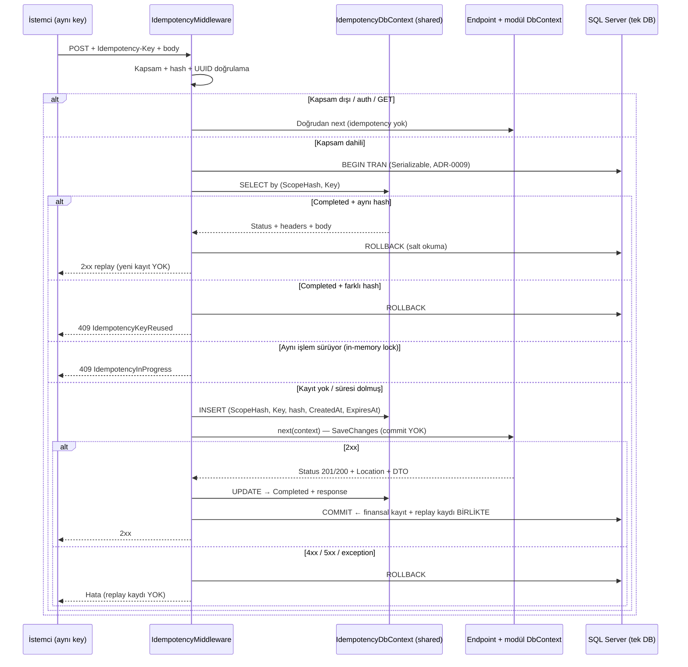

# FinTrack — Idempotency Teknik Tasarımı

**Sürüm:** 1.0
**Tarih:** 2026-11-18
**Durum:** ⏳ Tasarım onayı bekliyor — **kod yazılmadı**
**Bağlı belgeler:** [Kararlar v1.1](10-karar-bekleyen-konular.md) · [İş Kuralları §2.7](05-is-kurallari.md) · [API Sözleşmeleri §1.4](06-api-sozlesmeleri.md) · [ADR-0009](adr/0009-moduller-arasi-atomik-yazma.md) · [Görev kartı](07-yol-haritasi-ve-ajan-gorev-standardi.md) §5

> Bu dosya, `docs/10` için verilen cevapların **teknik tasarım çıktısıdır**.
> Kullanıcı onayı olmadan uygulamaya geçilmez. Özellikle §4 (çökme/atomiklik),
> §5 (migration ve modül DbContext'leri) ve §7 (mobil kalıcı kayıt) onay
> bekleyen tasarım kararlarıdır.

---

## 1. Kapsam ve onaylanan kararlar

| Madde | Karar | Not / kısıt |
|---|---|---|
| 1.1 | **A** | Finansal/mutasyon `POST` zorunlu; auth `POST` kapsam dışı |
| 1.2 | **A** | `userId + method + route template + route değerleri + anahtar`; query string hariç |
| 1.3 | **A** | Canonical JSON + SHA-256; ham gövde saklanmaz; deterministik kurallar §3 |
| 1.4 | **A** (mimari koşulla) | Host sahipliğinde `shared.IdempotencyKeys`; modüller tabloya erişmez; modül DbContext/migration düzeni korunur |
| 1.5 | **A** (küçük eklemeyle) | 24 saat; background job yok; erişimde + sınırlı toplu temizlik (§6) |
| 1.6 | **Onaylanmadı — tasarım önerisi sunuldu** | 5 dk stale timeout tek başına reddedildi. Çökme penceresi çözülmeden kod yok (§4) |
| 1.7 | **A** | `register/login/refresh/logout` kapsam dışı; token yanıtları saklanmaz |
| 1.8 | **A** | Yalnızca 2xx replay; 4xx/5xx kalıcı kayıt olmaz |
| 1.9 | **A** | `400 ValidationFailed`, alan `idempotencyKey` |
| 1.10 | **B** (geliştirilmiş) | Uygulama yeniden başlasa da bekleyen işlem korunur; çoklu bekleyen işlem; offline yazma kuyruğu **değil** (§7) |
| 1.11 | **A** | Tüm kapsam + entegrasyon testleri zorunlu (§4.7) |
| 1.12 | **A** | Host middleware; modül sınırları korunur |
| 2.1 | **A** | Windows manuel UI smoke yapılacak (görev kartında doğrulama maddesi) |
| 2.2 | **A** | LocalDB smoke verileri silinecek |
| 2.3 | **A** | Git geçmişine dokunulmayacak |
| 2.4 | **A** | Son docs-only CI run'ı dokümanlara eklenmeyecek |
| 3 | **A** | Idempotency sonrası v1.1 önceliği: parola sıfırlama + e-posta doğrulama |

### 1.1 Kapsam dahili `POST` uç noktaları

| Prefix | İşlemler |
|---|---|
| `/api/v1/expenses` | oluşturma, iptal |
| `/api/v1/categories` | oluşturma, arşivleme |
| `/api/v1/expenses/{id}/refunds` | oluşturma, iptal |
| `/api/v1/cash-inflows` | oluşturma, iptal |
| `/api/v1/cards` | oluşturma, arşivleme |
| `/api/v1/cards/{id}/payments` | oluşturma, iptal |
| `/api/v1/cards/{id}/statements` | oluşturma, iptal |
| `/api/v1/cards/{id}/cash-advances` | oluşturma, iptal |
| `/api/v1/personal-debts` | oluşturma, iptal, geri ödeme, geri ödeme iptali |
| `/api/v1/loans` | oluşturma, iptal, taksit ödeme, ödeme iptali |

**Kapsam dışı:** `/api/v1/auth/*` (register, login, refresh, logout), tüm `GET`,
`PUT`, `DELETE`, `/api/v1/reports/*` (salt okunur).

> Middleware kapsamı **pozitif liste** ile belirler: yukarıdaki prefix'lerden
> biriyle başlayan `POST` dahil, `/api/v1/auth` açıkça hariç. Yeni bir mutasyon
> `POST` eklenirse sözleşme ve bu liste aynı commit'te güncellenir; aksi halde
> yeni uç nokta korumasız kalır (risk: §4.8 R6).

---

## 2. Bileşenler ve katman yerleşimi

```text
Mobil (PendingOperationStore)
        │ Idempotency-Key + aynı gövde
        ▼
Host pipeline
  IdempotencyMiddleware  ──► IWriteTransactionScopeFactory.BeginAsync()
        │                    (ADR-0009: tek DbConnection, Serializable)
        │
        ├─ IdempotencyDbContext  (shared şeması, host sahipliğinde)
        │       └─ aynı transaction'a UseTransaction(scope.Transaction)
        │
        ├─ Modül DbContext'leri  (expenses/inflows/cards/debts)
        │       └─ aynı transaction'a Enlist(scope)
        │
        └─ Endpoint / handler (iş kuralı, SaveChanges)
                 │
                 ▼ 2xx ise yanıtı tamponla → kaydı Completed yap → TEK commit
```

**Sorumluluklar**

| Bileşen | Yer | Görev |
|---|---|---|
| `IdempotencyMiddleware` | `FinTrack.Api` (host) | Header doğrulama, kapsam belirleme, gövde hash'leme, transaction açma, yanıt tamponlama, replay |
| `IIdempotencyScope` | Host `ModuleContracts` | Kullanıcı + method + route template + route değerleri + anahtar'dan hesaplanan `ScopeHash` |
| `IdempotencyDbContext` | `FinTrack.Api/Idempotency` | `shared.IdempotencyKeys` erişimi; host dışından referans alınmaz |
| `IIdempotencyStore` | Host | Kayıt arama / ekleme / tamamlama / sınırlı temizlik |
| `IWriteTransactionScopeAccessor` | `ModuleContracts` | Aktif HOST transaction'ını modül handler/factory'lerine okunur şekilde sunar |
| `PendingOperationStore` | `FinTrack.Mobile.Core` | Bekleyen işlemin anahtarı + gövdesi + durumu (şifreli, yerel) |

Modüller **Idempotency tablosunu bilmez**; yalnızca zaten var olan
`IWriteTransactionScope` sözleşmesini kullanırlar (ADR-0009).

---

## 3. Anahtar kapsamı ve gövde kanonikleştirme (1.2 / 1.3)

### 3.1 Kapsam dizesi

```text
scopeInput = userId + "\n" + HTTP_METHOD + "\n" + routeTemplate + "\n"
           + canonicalRouteValues + "\n" + idempotencyKey
ScopeHash  = SHA256(UTF8(scopeInput))      // 64 karakter lowercase hex
```

- `routeTemplate` örn. `/api/v1/loans/{id}/installments/{number}/pay`.
- `canonicalRouteValues` = route değerlerinin ada göre sıralanmış
  `ad=değer` çiftleri (deterministik). Farklı `{id}` → farklı kapsam.
- **Query string girmez.** (Örn. `?page=2` aynı işlem sayılır.)
- `userId` JWT `sub` claim'inden alınır; gövdeden veya header'dan gelen
  kullanıcı bilgisine güvenilmez.
- Benzersizlik: `UNIQUE (ScopeHash, Key)`. Farklı kullanıcıların aynı anahtarı
  kullanması güvenlidir.

### 3.2 Canonical JSON kuralları (öneri — onay bekliyor)

Standart **JCS / RFC 8785** yaklaşımı esas alınır; harici paket eklenmeden
`System.Text.Json.Nodes` ile aynı sonucu üreten küçük bir canonicalizer önerilir.
Kural seti:

1. JSON parse edilir; boşluklar tamamen kaldırılır.
2. Nesne özellikleri **adlarına göre ordinal (UTF-16 code unit) sıralanır**;
   iç içe nesneler recursive uygulanır.
3. Dizilerin **sırası korunur** (anlamsaldır); sıralama yapılmaz.
4. Sayılar normalize edilir: `decimal` ayrıştırılabilir ise trailing sıfırlar
   kaldırılır (`1.0` → `1`), aksi halde round-trip (`R`) gösterimi kullanılır.
   `1e2` ve `100` aynı canonical değerine düşer.
5. String'ler aynen korunur; kaçışlar canonical writer tarafından normalize
   edilir (`\u0041` ile `A` aynıdır).
6. `null` korunur; eksik alan ile `null` **farklıdır** (DTO sözleşmesinde zaten
   ayrı anlamları var).
7. Geçersiz JSON veya `application/json` dışı gövde → `400 ValidationFailed`
   (alan `idempotencyKey` veya `body`).

`RequestHash = SHA256(UTF8(canonicalJson))` → 64 karakter hex. **Ham gövde,
kişisel veri veya token saklanmaz.** Saklanan yanıt gövdesi yalnızca 2xx DTO'sudur.

**Riskler**
- **R1 — Sayı yuvarlama farkları:** `decimal` ve `double` sınırlarında farklı
  canonical sonuç doğabilir. Azaltma: para alanları zaten `decimal`; test
  vektörleri (§4.7 S13) zorunlu.
- **R2 — Yeni DTO alanları:** canonicalizer tüm alanları gördüğü için yeni alan
  eklemek hash'ı değiştirir; bu beklenir (aynı anahtar + farklı gövde → 409).
- **R3 — Paket tercihi:** Harici JCS kütüphanesi kullanılırsa ADR gerekir; v1.1
  için dahili uygulama önerilir.

---

## 4. Çökme, atomiklik ve `InProgress` (1.6) — **onay bekleyen ana tasarım**

### 4.1 Neden "5 dk stale timeout" reddedildi

Kullanıcının işaret ettiği pencere gerçektir:

```text
handler SaveChanges() ── COMMIT ── [ÇÖKME] ── idempotency "Completed" yazılamadı
```

Bu durumda kalıcı bir `InProgress` kaydı görünür. 5 dakika sonra otomatik
yeniden çalıştırma, **finansal kaydı ikinci kez oluşturur**. Dolayısıyla
"stale InProgress → yeniden dene" kuralı güvenli değildir.

### 4.2 Önerilen karar: idempotency kaydı ile iş kaydı **tek transaction'da** commit edilir

ADR-0009 zaten tek DB / tek `DbConnection` / açık `Serializable` transaction
altyapısını sağlıyor. Bu altyapı v1.1'de **tüm mutasyon POST'larına**
genişletilir:

1. Middleware kapsam dahili isteği yakalar, header/gövdeyi doğrular.
2. `IWriteTransactionScopeFactory.BeginAsync()` ile **tek transaction** açılır
   (`IWriteConnectionProvider.Connection` üzerinde, `Serializable`).
3. `IWriteTransactionScopeAccessor.Current` bu scope'u ayarlar.
4. `IdempotencyDbContext` ve ilgili modül DbContext'leri **aynı transaction'a**
   katılır (`Database.UseTransaction(scope.Transaction)`).
5. Endpoint çalışır; modül `SaveChangesAsync` çağrıları yapılır ama **commit
   yapılmaz**.
6. Yanıt 2xx ise: durum kodu + izin verilen başlıklar (`Location`) + gövde
   tamponlanır; idempotency kaydı `Completed` olarak yazılır.
7. **`scope.CommitAsync()` tek seferde çağrılır.** Finansal kayıt ve replay
   kaydı birlikte görünür olur.
8. 4xx/5xx/istisna ise scope dispose → rollback; replay kaydı oluşmaz.

**Sonuç:** Kalıcı `InProgress` satırı **hiç oluşmaz**. `InProgress` yalnızca
süreç içindeki geçici bir durumdur; `409 IdempotencyInProgress` yalnızca aynı
anahtarlı istek hâlüyle işlenirken döner. Stale lock kurtarma gerekmez.

**Yeni hata kodu önerilmiyor.** Mevcut üç kodun anlamı netleştirilir:

| Kod | Yeni kesin anlamı |
|---|---|
| `409 IdempotencyInProgress` | Aynı kapsam+anahtar şu anda işleniyor; tekrar dene |
| `409 IdempotencyKeyReused` | Tamamlanmış kayıt var ama gövde hash'ı farklı |
| `400 ValidationFailed` | Header eksik / UUID değil / gövde JSON değil |

### 4.3 Akış diyagramı



### 4.4 Hata pencereleri

| # | Pencere | Sonuç | Güvenli mi? |
|---|---|---|---|
| W1 | Header/gövde doğrulanamadı | `400`, transaction açılmadı | ✅ |
| W2 | Transaction açıldı, endpoint commit öncesi çöktü | SQL connection kopunca rollback; key kaydı da yok | ✅ yeniden denenebilir |
| W3 | `SaveChanges` sonrası, `Completed` yazılmadan çökme | Her ikisi de **uncommitted** → ikisi de rollback | ✅ çift kayıt yok |
| W4 | `CommitAsync` sonrası, yanıt istemciye gitmeden çökme | Kayıt `Completed` + yanıt gövdesi DB'de | ✅ replay aynı 201 + `Location` döner |
| W5 | Aynı işlem sürerken ikinci istek (aynı process) | `409 IdempotencyInProgress` | ✅ |
| W6 | İkinci istek başka instance'ta | Unique index'te bekler; ilk commit olunca replay / 409 Reused | ✅ (gecikme riski: R5) |
| W7 | 4xx döndü, istemci aynı key ile tekrar denedi | Rollback olduğu için kayıt yok; istek normal çalışır | ✅ |
| W8 | Süresi dolmuş kayıt | Erişimde silinir, yeni işlem gibi çalışır | ✅ (TTL sözleşmesi: 24 s) |

> **Kritik not:** W8'de 24 saat sonra aynı anahtarın tekrar kullanılması
> "yeni istek" sayılır. Mobil istemci kesin başarıda bekleyen kaydı siler,
> dolayısıyla anahtarı 24 saat sonra yeniden kullanmaz (§7).

### 4.5 Modül DbContext'leri ile çalışma (ADR-0009 genişletmesi)

| Modül | Mevcut durum | v1.1'deki değişiklik |
|---|---|---|
| Expenses | Kendi `ITransactionScopeFactory`'si (`db.Database.BeginTransactionAsync`) var; `Enlist` yok | `IUnitOfWork.Enlist(IWriteTransactionScope?)` eklenir; handler'lar host scope'unu kullanır; yerel `BeginSerializableAsync` host scope varken **no-op wrapper** döner |
| CashInflows | `Enlist` var; `BeginAsync()` çağrıları var | `BeginAsync` host scope varken no-op wrapper döner; `Enlist(accessor.Current)` kullanılır |
| CreditCards | `Enlist` var; `BeginAsync()` çağrıları var | Aynı |
| Debts | `Enlist` var; `BeginAsync()` çağrıları var | Aynı |
| Reporting | Salt okunur | Değişiklik yok |
| Identity | Kapsam dışı | Değişiklik yok |

`IWriteTransactionScopeFactory.BeginAsync()` davranışı:

- `IWriteTransactionScopeAccessor.Current != null` → aynı `Transaction`'ı taşıyan
  **no-op wrapper** (Commit/Dispose etkisiz) döner; handler kendi `await using`
  bloğunu bozmadan çalışmaya devam eder.
- `Current == null` → mevcut davranış (yeni transaction; örn. migration dışı
  arka plan çağrıları).

Böylece handler iş mantığı değişmez; yalnızca transaction'ın **sahibi** host
olur ve commit tek noktada yapılır.

### 4.6 Riskler ve azaltmalar

| # | Risk | Azaltma |
|---|---|---|
| R1 | Uzun transaction → kilit süresi artışı | Transaction yalnızca mutasyon POST'ları kapsar; handler içinde dış I/O yok; command timeout yapılandırılır |
| R2 | `Serializable` deadlock (SQL 1205) | Rollback + aynı key/body ile sınırlı yeniden deneme; test S19 |
| R3 | Yanıt gövdesi tamponu büyür | POST DTO'ları küçük; 64 KB üst sınır, aşımı testte hata sayılır; `Location` allowlist'i |
| R4 | Modül handler'ı kendi transaction'ını açarsa çift transaction hatası | §4.5 no-op wrapper + mimari testi: kapsam dahili handler'da `BeginTransactionAsync` çağrısı yok |
| R5 | İkinci instance unique index'te bloklanır | Kısa lock timeout + istemciye `409 InProgress` dönüşü; dağıtık kilit v1.1 dışı, ADR gerekir |
| R6 | Yeni mutasyon POST listeye eklenmez | Mimari testi: tüm `MapPost` endpoint'leri pozitif listede ya da `/api/v1/auth` olmalı |
| R7 | Idempotency kaydı yazılır ama modül `SaveChanges` yapmaz | Tek commit + test S18 (cross-module atomiklik) |

### 4.7 Test senaryoları (entegrasyon zorunlu — 1.11)

| # | Senaryo | Beklenen |
|---|---|---|
| S1 | Aynı key + aynı gövde iki kez | Aynı status/gövde/`Location`; veritabanında **1** finansal kayıt |
| S2 | Aynı key + farklı gövde | `409 IdempotencyKeyReused`; yeni kayıt yok |
| S3 | Aynı process'te eşzamanlı aynı istek | Biri 2xx, diğeri `409 IdempotencyInProgress`; 1 kayıt |
| S4 | İki app instance, aynı key | Bekleme sonrası replay; 1 kayıt |
| S5 | Test hook: `SaveChanges` sonrası, commit öncesi çökme | Rollback; retry ile tam 1 kayıt |
| S6 | Test hook: commit sonrası, yanıt yazılmadan çökme | Retry aynı 201 + `Location`; 1 kayıt |
| S7 | Doğrulama hatası (4xx) + aynı key ile retry | İlkinde kayıt yok; ikincisinde 1 kayıt |
| S8 | Süresi dolmuş kayıt | Eski kayıt temizlenir; istek yeni gibi çalışır |
| S9 | Farklı kullanıcı, aynı key | İkisi de başarılı; kendi kayıtları |
| S10 | Aynı key, farklı route template | İkisi de başarılı (kapsam ayrı) |
| S11 | Aynı key, farklı route değeri (`{id}`) | İkisi de başarılı |
| S12 | Aynı key, farklı query string | Replay; yeni kayıt yok |
| S13 | Canonical JSON: özellik sırası / iç içe nesne / sayı (`1.0` vs `1`) / dizi sırası | Aynı hash veya farklı hash beklentisi karşılanır |
| S14 | Header yok / geçersiz UUID / bozuk JSON | `400 ValidationFailed`, alan `idempotencyKey` |
| S15 | `/api/v1/auth/login` + key | Header yok sayılır, idempotency kaydı oluşmaz |
| S16 | Mobil restart: `SentUnconfirmed` kayıt aynı key/body ile yeniden gönderilir | Replay; 1 kayıt |
| S17 | 1500 süresi dolmuş kayıt + tetiklenen temizlik | En fazla 1000 satır silinir; uzun kilit yok |
| S18 | Nakit avans + para girişi (ADR-0009) idempotency altında | Commit öncesi çökme → ikisi de yok; sonrası → ikisi de var |
| S19 | SQL 1205 deadlock sonrası aynı key ile retry | Tam 1 kayıt |
| S20 | 64 KB üstü 2xx yanıt | Testte hata/uyarı; replay kaydı oluşmaz veya sözleşme ihlali raporlanır |

---

## 5. Saklama, migration ve host sahipliği (1.4)

### 5.1 Şema (öneri)

`shared.IdempotencyKeys`

| Kolon | Tip | Not |
|---|---|---|
| `Id` | `bigint IDENTITY` | PK |
| `ScopeHash` | `char(64)` | §3.1; userId dahil |
| `Key` | `nvarchar(36)` | UUID `D` formatı, normalize |
| `RequestHash` | `char(64)` | canonical JSON SHA-256 |
| `Status` | `tinyint` | Yalnızca `Completed` (2) kalıcı yazılır; `InProgress` (1) geçicidir |
| `ResponseStatusCode` | `int` | 2xx |
| `ResponseHeaders` | `nvarchar(max)` | Yalnızca allowlist: `Location` |
| `ResponseBody` | `nvarchar(max)` | 2xx JSON DTO |
| `CreatedAtUtc` | `datetime2` | |
| `CompletedAtUtc` | `datetime2` | |
| `ExpiresAtUtc` | `datetime2` | `CreatedAtUtc + 24h` |

İndeksler:
- `UNIQUE (ScopeHash, Key)` — replay ve çakışma tespiti.
- `IX (ExpiresAtUtc)` — sınırlı temizlik.

`RequestHash` ile `ResponseBody` birlikte saklanır; token/auth yanıtı asla
yazılmaz (auth kapsam dışı).

### 5.2 Migration mekanizması

- `IdempotencyDbContext` ve migration dosyaları **host projesinde**
  (`src/Host/FinTrack.Api/Idempotency/`) bulunur. Yeni proje **açılmaz**.
- Migration, modüllerle aynı desende `IDesignTimeDbContextFactory` ile
  üretilir; connection string host config'inden gelir.
- Runtime DI kaydı modülleriyle aynıdır:
  `UseFinTrackSqlServer(options, IWriteConnectionProvider.Connection)` — böylece
  aynı connection/transaction'a katılır.
- `Program.cs` migration bloğunda sıra:
  `identity` → **`idempotency`** → modül migration'ları (`IModuleMigration`).
- Modül DbContext'lerinin kendi şemaları (expenses/inflows/cards/debts)
  **değişmez**; idempotency tablosuna hiçbir modül referans vermez.

**Risk R8:** Host migration'ı modüllerden önce uygulanır; ilk açılışta
`shared` şeması oluşur. Migration bazı ortamlarda `CREATE SCHEMA` gerektirebilir;
design-time factory ve `--migrate` yolu test edilir.

---

## 6. TTL ve temizlik (1.5)

- `ExpiresAtUtc = CreatedAtUtc + 24 saat`.
- Erişimde: kayıt bulunup `ExpiresAtUtc < nowUtc` ise **aynı transaction'da**
  silinir ve istek yeni gibi işlenir (W8).
- Periyodik background job **yok**. Bunun yerine kapsam dahili bir istek
  geldiğinde, en fazla **saatte bir** ve **en fazla 1000 satır** silen
  `DELETE TOP (1000) FROM shared.IdempotencyKeys WHERE ExpiresAtUtc < @now`
  çalıştırılır. Bu çağrı istek transaction'ının dışında, kısa ayrı bir
  transaction ile yapılır (kilit süresini uzatmaz).
- Temizlik hatası isteği **bloklamaz**; loglanır (Serilog).
- Süresi dolmuş anahtarın tekrar kullanımı replay garantisi vermez; istemci
  sözleşmesi bunu yasaklar (§7).

---

## 7. Mobil bekleyen işlem deposu (1.10) — **onay bekleyen tasarım**

### 7.1 Karar

`SecureStorage` **veri deposu olarak kullanılmaz** (Android'de küçük kotası var,
büyük JSON gövdelere uygun değil). Bunun yerine:

- **App-private SQLite** (`Microsoft.Data.Sqlite` — yeni paket, gerekçe: tek
  dosya, platformlar arası, işlem destekli).
- Gövde `AES-GCM` ile şifrelenir; **anahtar** platform güvenli deposunda
  (`SecureStorage` → Android Keystore / iOS Keychain / Windows DPAPI) tutulur.
- Yeni paket için ADR/görev kartı gerekçesi: hassas finansal gövdenin cihazda
  düz metin tutulmaması. (SQLCipher alternatifi: native bağımlılık → reddedildi.)

### 7.2 Kayıt modeli

```text
PendingOperations
  Key            TEXT PK        -- UUID
  Method         TEXT           -- daima POST
  Route          TEXT           -- /api/v1/expenses vb.
  BodyCipher     BLOB           -- AES-GCM(canonical istek gövdesi)
  Nonce          BLOB
  CreatedAtUtc   TEXT
  State          TEXT           -- Created | SentUnconfirmed
  AttemptCount   INT
  LastError      TEXT (nullable)
```

`Location`/yanıt gövdesi saklanmaz; sunucu replay eder. En fazla 50 bekleyen
işlem; aşımda en eskisi uyarıyla silinir. Tek bir gövde için 64 KB üst sınır.

### 7.3 Durum makinesi

```text
[Kullanıcı aksiyonu]
   → UUID üret + kayıt (State=Created) + gövdeyi şifrele
   → handler isteği AĞA VERMEDEN ÖNCE State=SentUnconfirmed yap
   → 2xx                     → kaydı SİL (kesin başarı)
   → 409 KeyReused / 4xx     → kaydı SİL + hatayı göster
   → 409 InProgress          → kaydı koru, üstel geri çekilme ile tekrar dene
   → timeout / 5xx / ağ hatası → kaydı koru (SentUnconfirmed)
   → uygulama yeniden açıldı → YALNIZCA SentUnconfirmed kayıtları, sınırlı
                                deneme (max 3) ile aynı key + aynı gövdeyle gönder
```

- `Created` (ağa hiç çıkmamış) kayıtlar **otomatik gönderilmez**; kullanıcı
  "Tekrar dene / Vazgeç" seçer. Böylece offline yazma kuyruğuna dönüşmez.
- `AuthHandler`: mevcut GET/HEAD/OPTIONS retry korunur. `POST` retry **yalnızca**
  isteğe eklenmiş pending-operation anahtarı varsa ve state
  `SentUnconfirmed` ise yapılır. Auth `POST`'ları bu kayda sahip olmadığı için
  retry edilmez. `PUT` retry kapalı kalır.
- Aynı isteğin gövdesi her denemede **aynı baytlardan** yeniden okunur
  (şifreli kayıttan çözülür); istemci serileştirme farkı oluşmaz.

### 7.4 Riskler

| # | Risk | Azaltma |
|---|---|---|
| R9 | Şifreleme anahtarı kaybolursa bekleyen kayıtlar okunamaz | Decrypt hatası → kaydı sil + kullanıcıya bilgi ver; sunucu kaydı etkilenmez (replay sunucuda) |
| R10 | Çoklu bekleyen işlem + aynı UUID | UUID v4; PK çakışması durumunda yeni UUID üret |
| R11 | Gövde boyutu kotası | 64 KB sınır; aşımda işlem reddedilir |
| R12 | "Offline kuyruğa dönüşme" | Yalnızca `SentUnconfirmed` otomatik; `Created` kullanıcı onayı bekler |
| R13 | 24 s TTL'den sonra replay imkânsız | Kayıt 24 s içinde temizlenir; başarıda anında silinir; uzun süre çevrimdışı kalan kayıt kullanıcıya "kesin sonuç yok" olarak gösterilir ve yeni anahtarla yeni işlem açılır |

---

## 8. Uygulama sırası (kod onayı sonrası)

1. `docs/05` §2.7, `docs/06` §1.4 güncellenmiş sözleşmeyi temel al.
2. Host: `IdempotencyDbContext` + migration + `IIdempotencyStore` + DI.
3. `IWriteTransactionScopeAccessor` + factory no-op wrapper (ADR-0009 genişletmesi).
4. Middleware: kapsam, hash, kilit, yanıt tamponu, replay, temizlik tetiği.
5. Modül `Enlist(scope)` uyumları (Expenses dâhil) — iş mantığı değişmez.
6. Entegrasyon testleri S1–S20 (Testcontainers MSSQL).
7. Mobil: `PendingOperationStore` + şifreleme + `AuthHandler` POST retry.
8. Mobil restart testi (S16) + Windows manuel smoke (2.1).
9. LocalDB smoke verilerinin temizliği (2.2).
10. CI (335/335 + yeni testler) yeşili, doküman sürümleri, DoD.

---

## 9. Onay bekleyen maddeler (kodlamadan önce kapatılacak)

1. **§4.2** — "Kalıcı `InProgress` yok, tek transaction, stale timeout yok"
   tasarımı onaylıyor musunuz? (1.6 maddesinin kapanışı)
2. **§4.5** — ADR-0009'un tüm mutasyon POST'larına genişletilmesi ve
   Expenses'in `Enlist` eklemesi kabul ediliyor mu?
3. **§3.2** — JCS/RFC 8785 tabanlı dahili canonicalizer kuralları yeterli mi?
4. **§5.1** — `shared.IdempotencyKeys` şeması ve unique index kabul ediliyor mu?
5. **§7.1** — SQLite + AES-GCM + `SecureStorage`'da yalnızca anahtar yaklaşımı
   ve yeni `Microsoft.Data.Sqlite` paketi onaylıyor mu?
6. **§7.3** — `SentUnconfirmed` otomatik kurtarma, `Created` kullanıcı onayı
   kuralı onaylıyor mu?

> Bu sorular "karar değişikliği" değil; **tasarım onayı** isteğidir. Cevap
> gelmeden `docs/11` v1.0 kalır, kod yazılmaz.

---

## 10. Değişiklik geçmişi

| Sürüm | Tarih | Değişiklik |
|---|---|---|
| 1.0 | 2026-11-18 | `docs/10` cevapları işlendi; 1.4/1.6/1.10 teknik tasarımı, çökme akış diyagramı, test senaryoları ve görev kartı referansı eklendi; tasarım onayı bekliyor |
